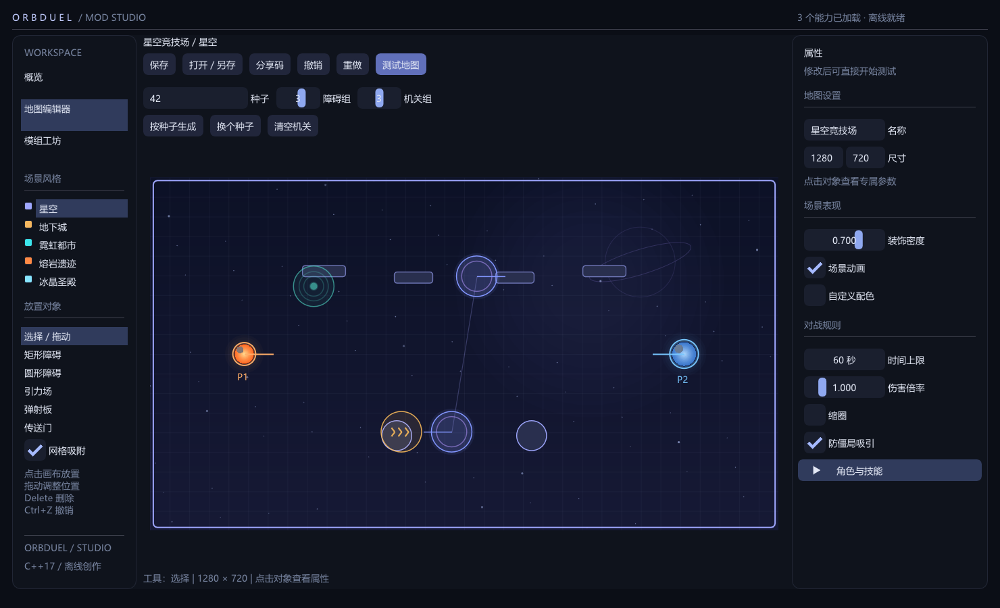

# OrbDuel / Mod Studio

OrbDuel is a C++17 physics auto-battler and offline arena workshop. Design an arena, write a gameplay mechanic as a standalone C++ mod, and playtest it without rebuilding the game.



## Download

Download the standalone Windows x64 build from [Release v0.3.0](https://github.com/HHHHia/OrbDuel-Mod-Studio/releases/tag/v0.3.0). Extract the archive and run `orbduel.exe`. The packaged game runs without Visual Studio.

## Build from Source

On Windows x64, install Visual Studio 2022 or Build Tools with the **Desktop development with C++** workload and CMake. SDL2 and Dear ImGui are included in the repository.

```powershell
.\build.ps1
.\build\bin\orbduel.exe
```

The script locates the CMake installation included with Visual Studio and builds the game and example mods. To build manually with MSVC x64:

```powershell
cmake -S . -B build -G "Visual Studio 17 2022" -A x64
cmake --build build --config Release --parallel
ctest --test-dir build -C Release --output-on-failure
```

The repository also includes source build and launch scripts for Apple Silicon. The validation notes describe the Windows test coverage. [macOS build guide](docs/MACOS.md) · [Validation notes](docs/VALIDATION.md)

## Create and Share an Arena

1. Open the Arena Editor and generate an arena from a seed.
2. Place rectangular or circular obstacles and mod objects on the canvas. Drag them to adjust their positions.
3. Select a portal to set its paired exit, exit direction, and speed multiplier. Other objects expose their own settings in the same panel.
4. Choose the fighters, abilities, time limit, shrinking rules, and theme. Start a playtest, then return to the editor to continue editing the same draft.
5. Save the arena or copy its offline share code. Anyone with the same mods installed can import the configuration.

Use `Ctrl+S` to save, `Ctrl+Z` and `Ctrl+Y` to undo and redo, `Delete` to remove a selected item, and `Esc` to clear the selection or return from a match.

The five arena themes are Cosmos, Dungeon, Neon City, Lava Ruins, and Ice Temple. Backgrounds, obstacle colors, decoration density, and animation can be adjusted independently of the physics rules. The workshop also offers configurable UI skins and an English and Chinese interface. It ships with Noto Sans SC for Chinese text. [Content and UI skin formats](docs/CONTENT_FORMAT.md)

## Write a C++ Mod

OrbDuel gives C++ learners a playable project they can extend. The mod API is designed to make the first change small and to support more involved ideas as authors gain experience. A beginner can change a few lines in a working template so an ability triggers only after a heavy hit. Using the same interface, a more experienced author can create a Guardian that tracks nearby enemies, intercepts them, and shields allies.

The host loads standalone plugins through `orbduel_register` and generates editor controls from the parameters each mod declares. The API can query entities, change their movement, handle events, and create independent combat entities. Portals, gravity fields, and launch pads are included as examples.

```powershell
powershell.exe -NoProfile -ExecutionPolicy Bypass -File .\mod-sdk\new-mod.ps1 -Id my-vortex -Name "My Vortex"
```

Open `user/mod-projects/my-vortex`, edit the C++ source to change behavior, or edit `mod.json` to change its defaults. Run `build-install.cmd`, select the game folder on the first run, and reload the mod in the Mod Workshop. New objects use the updated defaults.

[First mod tutorial](docs/FIRST_MOD.md) · [Custom C++ abilities](docs/CUSTOM_ABILITIES.md) · [Combat entities and summons](docs/COMBAT_ENTITIES.md) · [Public SDK header](mod-sdk/include/orbduel_mod.hpp)

## Combat and Balance

Fighters move automatically. Normal collision damage depends on the arena multiplier, the defender's contact multiplier, and the attacker's incoming speed. Charged rams, piercing attacks, gravity, and mod damage have separate rules. The workshop defaults to a one-minute match, with remaining health percentage deciding the result at timeout. Arena shrinking and stalemate prevention can be configured in the editor.

The recorded balance benchmark covered eight fighters across four arena types. Over 28,672 seeded matches with sides swapped, overall scores ranged from 45.16% to 54.43%, with draws counted as half a point. New fighters and custom mods can be evaluated with the same runner. [Balance report and reproduction steps](docs/BALANCE.md)

## Command-Line Examples

```powershell
.\build\bin\orbduel.exe --selftest --window
.\build\bin\orbduel.exe --headless --seconds 60
.\build\bin\orbduel.exe --autotest 600
.\build\bin\orbduel.exe --scene user/arena.json --play
.\build\bin\orbduel.exe --no-menu --map duel-basic
.\build\bin\orbduel.exe --mods path/to/mods
.\build\bin\orbduel.exe --lang en
.\build\bin\orbduel.exe --ui-skin aurora
.\build\bin\orbduel.exe --sfx-test
```

`--headless` runs the simulation without a window. `--autotest` runs repeated matches and reports collisions, mod activations, and the longest idle interval. `--lang en|zh` selects the interface and built-in content language. `--sfx-test` plays the bundled WAV files in filename order. Use `tools/package.ps1` to assemble a standalone Windows package with the game, mods, assets, SDK, and tutorials.

## Documentation and Demos

- [Quick Start](docs/QUICK_START.md)
- [Mod Studio Guide](docs/MOD_STUDIO.md)
- [Architecture](docs/ARCHITECTURE.md)
- [Implementation and validation status](docs/STATUS.md)
- [Demo script](docs/DEMO_SCRIPT.md)
- [Gameplay videos and screenshots](docs/presentation-media)

## License

OrbDuel is available under the MIT license. SDL2 uses the zlib license, Dear ImGui uses the MIT license, and the bundled font uses the SIL Open Font License. License notices are included with the source and release package. [Project license](LICENSE) · [Asset credits](content/ASSETS.md)
