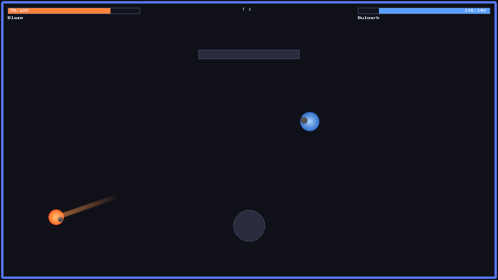

# 实现状态 / Status

> **每次合并前更新这张表。** AI 开工第一件事是读这里，别猜哪些已经能跑。
> 最后更新：2026-11-13（主菜单：开始 / 退出 / 左右各自选角）

## 总览

| 模块 | 接口 | 实现 | 说明 |
|---|---|---|---|
| `core/Types` | ✅ | ✅ | Vec2/Rgba/Rect 与内联数学 |
| `core/Clock` | ✅ | ✅ | 固定步长累加器（1/120，单帧最多 8 步） |
| `core/Rng` | ✅ | ✅ | xorshift64*，同 seed 可复现 |
| `core/Event` | ✅ | ✅ | 队列式事件总线，步末统一派发 |
| `core/Log` | ✅ | ✅ | 控制台 + 最近 16 行缓冲 |
| `physics/Body` | ✅ | ✅ | 结构体 |
| `physics/Arena` | ✅ | ✅ | 缩圈插值 + 越界推回 + 障碍压碎 |
| `physics/World` | ✅ | ✅ | 积分 / 球-球 / 障碍 / 墙反弹（带抖动） |
| `physics/Collision` | ✅ | ✅ | 圆-圆、圆-矩形、圆-静态圆（解析解） |
| `render/Renderer` | ✅ | ✅ | 窗口 / 画圆 / 线 / 矩形 / 精灵 / TTF 文本 / 截图 |
| `render/AssetCache` | ✅ | ✅ | PNG 懒加载 + 热重载接口 |
| `render/Fx` | ✅ | ✅ | 粒子 / 圆环 / 拖尾 / 震屏 / hit-stop（事件驱动） |
| `render/DebugDraw` | ✅ | ❌ | 头文件在，实现未写 |
| `content/DataModel` | ✅ | ✅ | 纯数据结构 |
| `content/ContentLoader` | ✅ | 🟡 | 解析 + 校验能跑；**热重载未接**（`poll()` 是空实现） |
| `match/Match` | ✅ | ✅ | HP、伤害、连击、死亡、结算 |
| `match/MatchRule` | ✅ | ✅ | `IMatchRule` + `HpRule` |
| `match/StallGuard` | ✅ | ✅ | L2 静默吸引（L1 抖动在 physics） |
| `match/Zone` | ✅ | ✅ | 缩圈调度（时间 + 静默触发，带预警） |
| `match/Skill` | ✅ | 🟡 | 冷却 + `add_speed` 生效；其余原语待接 |
| `game/Game` | ✅ | ✅ | 主循环、装配、HUD、结算、菜单↔对局切换 |
| `game/Menu` | ✅ | ✅ | 主菜单：开始 / 退出（确认框）/ 左右各自选角，读 `content/characters/` 不写死 |
| 内容包 | — | ✅ | 2 角色 / 4 技能 / 1 地图 / 1 字体 |

图例：✅ 完成 / 🟡 部分 / ❌ 未开始

## 现在能玩什么

```powershell
.\build\bin\orbduel.exe                 # 开主菜单（点开始游戏 / 按 Enter 进对局）
.\build\bin\orbduel.exe --no-menu       # 跳过菜单直接开局
.\build\bin\orbduel.exe --seed 42       # 固定随机种子，可复现
.\build\bin\orbduel.exe --char blaze --enemy bulwark --map duel-basic   # 参数只做菜单预选
.\build\bin\orbduel.exe --seconds 10    # 跑 10 秒自动退出
.\build\bin\orbduel.exe --screenshot out.png   # 第 2 秒截图后退出（在菜单里就截菜单）
```

- 启动先进主菜单：左右两张卡各自用 `<` `>` 切换角色（可以选同一个角色互打），`START GAME` 或 Enter 开局，`QUIT GAME` 弹确认框（点 No / 点框外 / ESC 取消）；
- 两球自动对撞，撞击按相对速度扣血，2 秒内连击有倍率；
- 25 秒后开始缩圈（每 12 秒一档，带 1 秒预警），场地缩小、障碍被压碎；
- 5 秒没碰撞会触发「静默吸引」，球会缓慢靠近（肉眼几乎看不出）；
- HP 归零 → 结算画面，显示 `RETURNING IN 5...`；期间按 `R` 重开同阵容，5 秒后自动回主菜单；
- 对局中 `ESC` 回主菜单（**ESC 不再退出进程**）；退出只能在菜单里点 `QUIT GAME` → `YES`。



## 验证记录（2026-11-13，主菜单）

| 项 | 结果 | 备注 |
|---|---|---|
| 全量源码编译（21 个 `.cpp`） | ✅ | `-Wall -Wextra` 零警告，14.3 s |
| 主菜单渲染 | ✅ | 1280×720：两张卡 + 头像 + 数值 + 技能名 + 按钮 |
| 菜单点击自检（`SDL_PushEvent` 模拟鼠标） | ✅ | 12 项全过：开始 / 左右切换 / 循环回绕 / 确认框点框外取消 / YES 退出 / ESC 取消 / Enter 开局 / 点空白无反应 |
| `--headless` 默认跳过菜单 | ✅ | 与改动前一致：`hits=1 hp0=78 hp1=118` |
| `--no-menu --headless --seconds 10` | ✅ | 同上，回归无变化 |
| 长跑 120 s | ✅ | 55 s 结算 → 5 s 倒计时 → 回菜单，无崩溃 |

## 验证记录（2026-11-09）

| 项 | 结果 | 备注 |
|---|---|---|
| 全量源码编译 | ✅ | `-Wall -Wextra` 零警告 |
| CMake + Ninja 构建 | ✅ | 23 个构建目标，`build/bin/orbduel.exe` |
| `--selftest` | ✅ | 退出码 0 |
| `--selftest --window` | ✅ | `video=windows, renderer=direct3d` |
| 无窗口跑完整一局 | ✅ | 55 s，7 次命中，正常结算 |
| 截图渲染 | ✅ | 1280×720，HUD/精灵/粒子/障碍都在 |
| 内容校验脚本 | ✅ | `2 characters, 4 skills, 1 maps` |

## 下一个该谁做什么

| 优先级 | 任务 | 负责人 | 依赖 |
|---|---|---|---|
| P0 | 热重载：`ContentLoader::poll()` + `AssetCache` 重载 + 屏幕报错 | C | 无 |
| P0 | 技能剩余原语：shield / lifesteal / slow_field / teleport / resize / bounce_boost | C | `Match` 上下文 |
| P1 | `DebugDraw`（F1 碰撞箱 / F2 场地 / F3 事件） | B | 无 |
| P1 | 缩圈压到球的持续伤害（`damagePerSec`，不计连击） | C | 无 |
| P2 | 角色/地图选择界面 | B | 热重载 |
| P2 | 碰撞箱偏移 `hitbox.offset` 接进物理 | A | 无 |

## 已知缺口

- 技能只有 `add_speed` 真的生效，其余原语是空的（会在日志里提示一次）。
- 没有热重载；改 JSON 要重启。
- 缩圈只推回球，还没做「压到球扣血」。
- 没有单元测试；物理回归靠 `--headless --seconds N` + 日志。
- `hitbox.offset` 还没进物理（现在只按半径算）。
- 没有音效。
- 主菜单不显示中文名：当前字体 PressStart2P 没有 CJK 字形，`name.zh` 会渲染成方框；要显示得换一个带中文的 TTF。
- 菜单只能用鼠标操作（键盘只有 Enter 开局、ESC 关确认框），没有方向键导航。
- 菜单不做地图选择，地图仍由 `--map` 决定。
